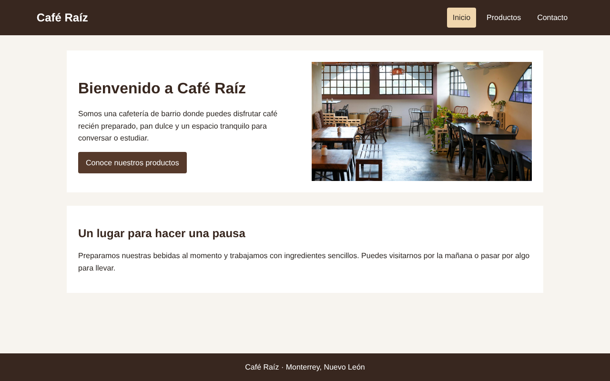
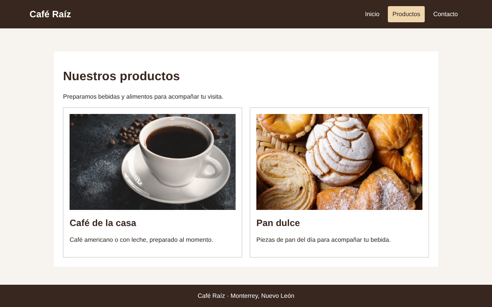
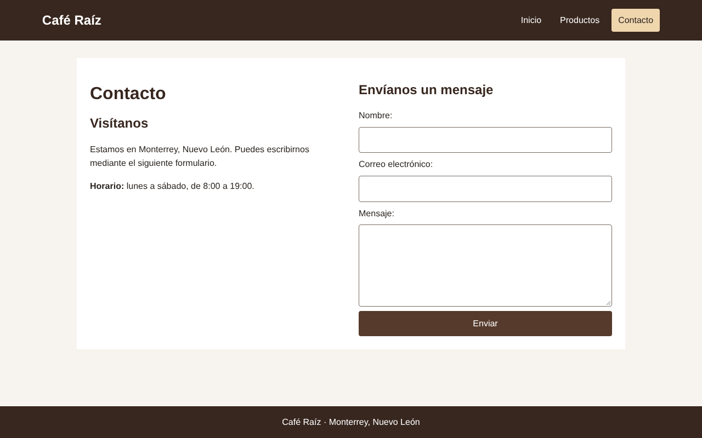
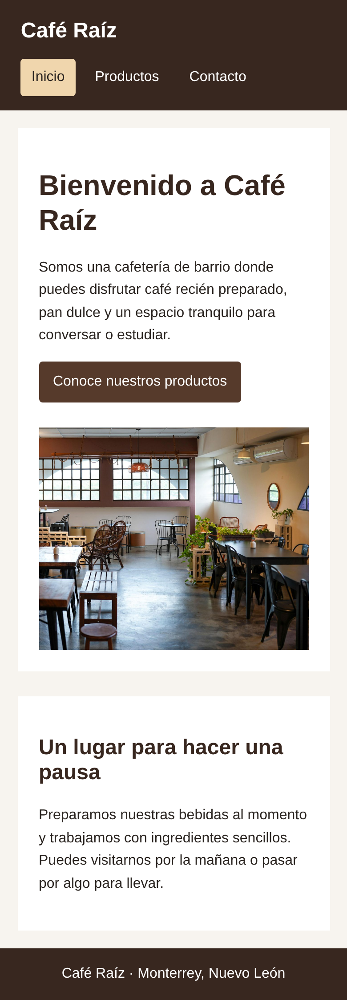
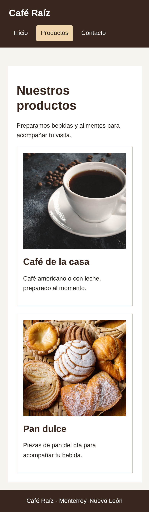
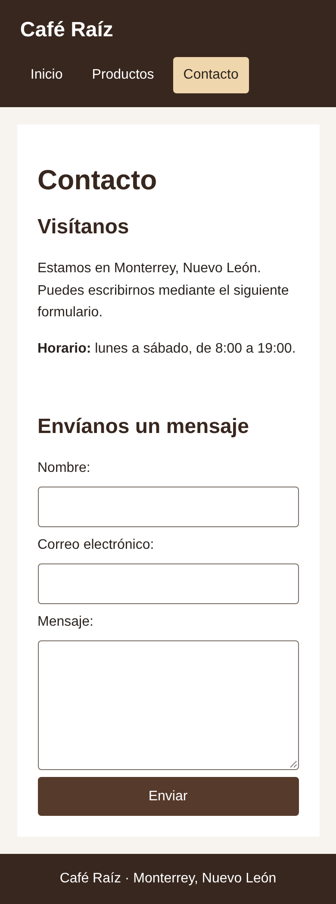

# Café Raíz

Sitio web responsivo, semántico y accesible para una cafetería ficticia de Monterrey, Nuevo León.
Proyecto de la **Actividad 2** del Laboratorio de Programación Web (FIME, UANL).

**Sitio publicado:** https://004sdffgh.github.io/Cafe/

## Objetivo

Construir y publicar un sitio web sencillo con HTML5 semántico y CSS moderno, que se vea correctamente tanto en computadora como en teléfono móvil, aplicando principios básicos de usabilidad, accesibilidad y validación de estándares.

## Tecnologías usadas

- HTML5 (etiquetas semánticas).
- CSS3 con **Flexbox** (encabezado, navegación, tarjetas de productos y formulario) y **Grid** (portada y contacto).
- Git, GitHub y GitHub Pages para publicar el sitio.

No se usa JavaScript, frameworks ni librerías externas.

## Estructura de archivos

```text
Cafe/
├── index.html        Inicio
├── servicios.html    Productos
├── contacto.html     Contacto (formulario)
├── style.css         Hoja de estilos única
├── README.md
├── foto1.jpg, foto2.jpg, foto3.jpg            Fotos del sitio
└── *-escritorio.png, *-movil.png              Capturas de pantalla
```

## Cumplimiento de la actividad

| Requisito | Cómo se cumple |
|---|---|
| Mínimo 3 vistas | Inicio, Productos y Contacto |
| Etiquetas semánticas | `header`, `nav`, `main`, `section`, `article` y `footer` en todas las páginas |
| Flexbox y/o Grid | Flexbox en encabezado, navegación, productos y formulario; Grid en portada y contacto. No se usan tablas para el diseño |
| Diseño responsivo | `<meta name="viewport">` y un breakpoint en `max-width: 700px`: las columnas pasan a una sola y el encabezado se apila. Sin desbordes horizontales en 320, 390, 768 y 1280 px |
| Accesibilidad | `alt` en todas las imágenes, `label` asociado a cada campo, un `h1` por página y luego `h2`, navegación con `aria-label` y `aria-current`, enlace "Saltar al contenido", foco visible con teclado y contraste mínimo de 5.19:1 (WCAG pide 4.5:1) |
| Validación | HTML y CSS sin errores (ver "Resultados de validación") |
| Publicación | GitHub Pages (liga arriba) |

## Capturas

### Escritorio (1280 px)

**Inicio**



**Productos**



**Contacto**



### Móvil (390 px)

**Inicio**



**Productos**



**Contacto**



## Resultados de validación

| Archivo | Validador | Resultado |
|---|---|---|
| index.html | Nu Html Checker (W3C, https://validator.w3.org/nu/) | Sin errores ni advertencias |
| servicios.html | Nu Html Checker (W3C) | Sin errores ni advertencias |
| contacto.html | Nu Html Checker (W3C) | Sin errores ni advertencias |
| style.css | Nu Html Checker en modo CSS (W3C) | Sin errores |

Errores corregidos durante la validación: en `index.html` la etiqueta `<meta>` de la descripción no tenía el atributo `name`, y se agregó el enlace "Saltar al contenido" que faltaba en esa página.
